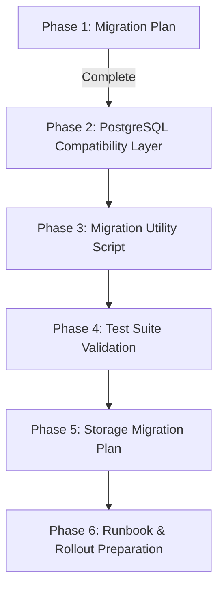

# CareerPilot AI — PostgreSQL Migration Plan

**Document Version:** 1.0  
**Date:** October 2026  
**Status:** Approved for Implementation Planning  
**Target Environment:** Local Development & Production (Render / Managed PostgreSQL)  
**Current Database:** SQLite 3 (`database.db`, ~1.9 MB, 27 tables)  
**Target Database:** PostgreSQL 15+ (using `psycopg2-binary` or `psycopg`)  

---

## Executive Summary

CareerPilot AI currently uses a raw-SQL SQLite architecture managed through `backend/database/db.py`, helper models in `backend/models/`, and services in `backend/services/`. This plan establishes a safe, zero-data-loss, dual-compatible migration to PostgreSQL without introducing an ORM (such as SQLAlchemy), preserving 100% of existing application behavior, route semantics, background workers, and user data.

---

## 1. Inventory of Database-Dependent Files

### 1.1 Core Database Layer
| File | Current Role | Necessary Changes |
| :--- | :--- | :--- |
| `backend/database/db.py` | SQLite connection manager (`sqlite3`), `get_db()`, `execute_query()`, `execute_one()`, `execute_insert()`, `execute_update()`, `table_exists()` | Redesign to dual-backend manager (PostgreSQL via connection pool if `DATABASE_URL` is set, SQLite fallback if not). Handle `%s` / `?` placeholder mapping, `RETURNING id` for inserts, `information_schema` for `table_exists()`, cursor dictionary abstraction. |
| `backend/database/schema.py` | SQLite DDL for 12 base tables and indexes; `init_db()` using `sqlite3.connect()` and `conn.executescript()` | Provide PostgreSQL-compatible DDL (types: `BIGSERIAL`, `TIMESTAMP`, `CHECK` constraints). Remove hardcoded `sqlite3` imports. |
| `backend/database/startup.py` | Startup migration runner; checks `os.path.exists(Config.DATABASE_PATH)` | Adapt to check database connectivity rather than local file existence when running under PostgreSQL. |
| `backend/config.py` | Reads configuration from `.env`; currently only reads `DATABASE_PATH` | Add `DATABASE_URL` reading, `DB_ENGINE` detection (`postgresql` if `DATABASE_URL` present, else `sqlite`). |

### 1.2 Model Migration Functions (Ad-hoc Schema Creators)
The application currently distributes table creation across individual model modules. Each contains raw SQLite DDL and direct `sqlite3.connect()` calls that must be adapted:
| File | Tables Managed | Migration Functions to Update |
| :--- | :--- | :--- |
| `backend/models/career_profile.py` | `career_profiles` | `migrate_career_profile_table()`: replace `sqlite3.connect()` with `get_db()`. In `create_empty()`, change `INSERT OR IGNORE` to PostgreSQL-compatible `INSERT ... ON CONFLICT (user_id) DO NOTHING`. |
| `backend/models/resume_version.py` | `resume_versions` | `migrate_resume_versions_table()`: replace `sqlite3.connect()` with `get_db()`. |
| `backend/models/job_notification.py` | `agent_profiles`, `job_notifications`, `agent_runs` | `migrate_notification_tables()`: replace `sqlite3.connect()` with `get_db()`. |
| `backend/models/chat.py` | `chat_sessions`, `chat_history` | `migrate_chat_sessions_table()`: use `execute_update()` instead of hardcoded SQLite DDL. |
| `backend/models/problem.py` | `problems`, `problem_templates`, `problem_test_cases`, `problem_submissions`, `user_problem_analytics`, `user_topic_scores`, `ai_problem_feedback`, `problem_hints_used` (8 tables) | `migrate_problem_solving_tables()`: replace `execute_query` for DDL with proper DDL execution; fix PostgreSQL data types and constraints. |
| `backend/models/admin.py` | `admin_users`, `admin_audit_logs` | `migrate_admin_tables()`: update DDL syntax, replace `execute_query` with DDL runner. |

### 1.3 Data Access Models (Parameter Binding & Query Execution)
All of the following model files use `backend.database.db` query helpers (`execute_query`, `execute_one`, `execute_insert`, `execute_update`):
- `backend/models/user.py` (users authentication and profiles)
- `backend/models/resume.py` (resumes and resume_analysis)
- `backend/models/chat.py` (sessions and chat_history)
- `backend/models/job.py` (job_history)
- `backend/models/interview.py` (interview_history)
- `backend/models/learning.py` (learning_roadmaps)
- `backend/models/project.py` (projects)
- `backend/models/career_profile.py` (career_profiles CRUD)
- `backend/models/resume_version.py` (resume_versions CRUD)
- `backend/models/job_notification.py` (agent_profiles, job_notifications, agent_runs)
- `backend/models/problem.py` (coding platform tables)
- `backend/models/admin.py` (admin_users, admin_audit_logs)

### 1.4 Services and Routes with Direct SQL
- `backend/services/admin_service.py`: Contains SQLite-specific date functions (`datetime('now', '-30 days')`, `datetime('now', '-7 days')`), substring calls (`substr(created_at, 1, 10)`), and week/month formatting (`strftime('%Y-W%W', ...)`).
- `backend/routes/problem_solving.py`: Directly queries `problem_submissions` with `execute_one` / `execute_query`.
- `backend/services/problem_service.py`: Direct analytical queries against problem solving tables.
- `backend/services/autonomous_agent.py`: Multi-threaded background agent worker creating database connections across threads.

---

## 2. Incompatible SQL Queries & PostgreSQL Differences

### 2.1 Query Placeholders
- **SQLite:** Uses `?` (positional).
- **PostgreSQL (`psycopg2`):** Uses `%s` (format-style positional).
- **Resolution Strategy:** The unified database manager in `backend/database/db.py` will transparently translate `?` placeholders to `%s` when executing against PostgreSQL, preserving backward compatibility for existing application code without requiring a manual find-and-replace of hundreds of `?` in stable business logic.

### 2.2 Last Inserted Row ID (`execute_insert`)
- **SQLite:** `cursor.lastrowid` returns the autoincrement ID.
- **PostgreSQL:** `cursor.lastrowid` is not supported by `psycopg2`.
- **Resolution Strategy:** When running on PostgreSQL, `execute_insert` will append `RETURNING id` (or table primary key) if not already present, execute `cursor.fetchone()`, and return the generated ID.

### 2.3 Dialect-Specific Date and String Functions
The following specific queries in `backend/services/admin_service.py` are incompatible with PostgreSQL:

1. **New Users (Last 30 Days)**
   - *SQLite:* `WHERE created_at >= datetime('now', '-30 days')`
   - *PostgreSQL:* `WHERE created_at >= NOW() - INTERVAL '30 days'`
   - *Compatible Form:* Standardize via query helper or dialect-aware condition:
     ```sql
     -- PostgreSQL
     WHERE created_at >= (NOW() - INTERVAL '30 days')
     ```

2. **Active Users (Last 7 Days)**
   - *SQLite:* `WHERE last_login >= datetime('now', '-7 days')`
   - *PostgreSQL:* `WHERE last_login >= NOW() - INTERVAL '7 days'`

3. **User Growth & Submissions Date Aggregation (Daily)**
   - *SQLite:* `SELECT substr(created_at, 1, 10) as reg_date, COUNT(*) ... GROUP BY reg_date`
   - *PostgreSQL:* `SELECT TO_CHAR(created_at, 'YYYY-MM-DD') as reg_date, COUNT(*) ... GROUP BY reg_date` (or `DATE(created_at)`)

4. **Weekly & Monthly AI Requests**
   - *SQLite:* `SELECT strftime('%Y-W%W', created_at) as week_num ...` and `strftime('%Y-%m', created_at) as month_num ...`
   - *PostgreSQL:* `SELECT TO_CHAR(created_at, 'IYYY-"W"IW') as week_num ...` and `SELECT TO_CHAR(created_at, 'YYYY-MM') as month_num ...`

### 2.4 Conflict Handling Syntax
- In `backend/models/career_profile.py`:
  - *SQLite:* `INSERT OR IGNORE INTO career_profiles (user_id) VALUES (?)`
  - *PostgreSQL:* `INSERT INTO career_profiles (user_id) VALUES (%s) ON CONFLICT (user_id) DO NOTHING`

### 2.5 Table Existence Checks
- *SQLite:* `SELECT name FROM sqlite_master WHERE type='table' AND name=?`
- *PostgreSQL:* `SELECT table_name FROM information_schema.tables WHERE table_schema = 'public' AND table_name = %s`

### 2.6 PRAGMA Directives
- `PRAGMA foreign_keys = ON;` and `PRAGMA journal_mode = WAL;` are SQLite-only and will cause syntax errors in PostgreSQL. They must only execute when the SQLite backend is active.

---

## 3. Detailed Verification of All 27 Tables & Schemas

Verification against `database.db` and model source code confirms the following 27 tables:

| # | Table Name | PK Column | Foreign Keys | Unique Constraints | JSON Columns | Boolean Columns (0/1) | Timestamp Columns |
| :- | :--- | :--- | :--- | :--- | :--- | :--- | :--- |
| 1 | `users` | `id` (INTEGER) | None | `username`, `email` | None | `is_active` | `last_login`, `created_at`, `updated_at` |
| 2 | `resumes` | `id` (INTEGER) | `user_id -> users(id)` | None | `parsed_data` | `is_primary` | `uploaded_at` |
| 3 | `resume_analysis` | `id` (INTEGER) | `resume_id -> resumes(id)`, `user_id -> users(id)` | None | `strong_skills`, `weak_skills`, `missing_keywords`, `grammar_issues`, `action_plan`, `full_analysis` | None | `analyzed_at` |
| 4 | `chat_sessions` | `session_id` (TEXT) | `user_id -> users(id)` | `session_id` (PK) | None | `is_pinned`, `is_archived` | `created_at`, `updated_at` |
| 5 | `chat_history` | `id` (INTEGER) | `user_id -> users(id)` | None | `metadata` | None | `created_at` |
| 6 | `job_history` | `id` (INTEGER) | `user_id -> users(id)` | None | `match_details` | None | `found_at`, `updated_at` |
| 7 | `interview_history` | `id` (INTEGER) | `user_id -> users(id)` | None | `questions`, `answers`, `evaluations` | None | `conducted_at` |
| 8 | `learning_roadmaps` | `id` (INTEGER) | `user_id -> users(id)` | None | `current_skills`, `roadmap_data`, `daily_plan`, `weekly_plan`, `resources` | None | `created_at`, `updated_at` |
| 9 | `projects` | `id` (INTEGER) | `user_id -> users(id)` | None | `skills`, `project_data` | None | `generated_at` |
| 10 | `settings` | `id` (INTEGER) | `user_id -> users(id)` | `user_id` | None | `notifications`, `email_alerts` | `updated_at` |
| 11 | `code_reviews` | `id` (INTEGER) | `user_id -> users(id)` | None | `review_data` | None | `reviewed_at` |
| 12 | `sql_queries` | `id` (INTEGER) | `user_id -> users(id)` | None | `analysis_data` | None | `analyzed_at` |
| 13 | `career_profiles` | `id` (INTEGER) | `user_id -> users(id)` | `user_id` | `skills`, `top_skills`, `soft_skills`, `technologies`, `certifications`, `projects` | 10 `*_is_manual` flags | `created_at`, `updated_at` |
| 14 | `resume_versions` | `id` (INTEGER) | `user_id -> users(id)` | None | `content`, `scores`, `suggestions` | None | `created_at` |
| 15 | `agent_profiles` | `id` (INTEGER) | `user_id -> users(id)` | `user_id` | `extracted_skills`, `target_roles`, `preferred_locations`, `experience_summary`, `raw_profile_json` | `is_active` | `created_at`, `updated_at` |
| 16 | `job_notifications` | `id` (INTEGER) | `user_id -> users(id)` | None | `skills_matched`, `skills_missing`, `market_analysis`, `salary_insights`, `raw_job_data` | `is_read`, `is_bookmarked` | `created_at`, `notified_at` |
| 17 | `agent_runs` | `id` (INTEGER) | `user_id -> users(id)` | None | `search_params`, `filters_applied`, `errors` | None | `started_at`, `completed_at` |
| 18 | `admin_users` | `id` (INTEGER) | None | `username`, `email` | None | `is_active` | `created_at`, `last_login` |
| 19 | `admin_audit_logs` | `id` (INTEGER) | None | None | None | None | `created_at` |
| 20 | `problems` | `id` (INTEGER) | None | None | `tags`, `hints` | None | `created_at` (TEXT) |
| 21 | `problem_templates` | `id` (INTEGER) | `problem_id -> problems(id)` | None | None | None | None |
| 22 | `problem_test_cases` | `id` (INTEGER) | `problem_id -> problems(id)` | None | None | `is_hidden` | None |
| 23 | `problem_submissions` | `id` (INTEGER) | `problem_id -> problems(id)` *(see Section 4)* | None | `coding_metrics` | None | `created_at` (TEXT) |
| 24 | `user_problem_analytics` | `id` (INTEGER) | None | `user_id` | None | None | `last_submission_at` (TEXT) |
| 25 | `user_topic_scores` | `id` (INTEGER) | None | `(user_id, topic)` | None | None | None |
| 26 | `ai_problem_feedback` | `id` (INTEGER) | `submission_id -> problem_submissions(id)` | None | `feedback_report` | None | `created_at` |
| 27 | `problem_hints_used` | `id` (INTEGER) | None | `(user_id, problem_id, hint_index)` | None | None | `created_at` |

---

## 4. Investigation of `problem_submissions.user_id` Foreign Key

### 4.1 Audit Observation vs. Reality
- **Audit Claim:** The audit noted that `problem_submissions.user_id` had a copy-paste bug referencing `problems(id)` instead of `users(id)`.
- **Actual Code & SQLite DDL Inspection:**
  In `database.db` and `backend/models/problem.py`:
  ```sql
  CREATE TABLE problem_submissions (
      id INTEGER PRIMARY KEY AUTOINCREMENT,
      user_id INTEGER NOT NULL,
      problem_id INTEGER NOT NULL,
      code TEXT NOT NULL,
      language TEXT NOT NULL,
      status TEXT NOT NULL,
      execution_time INTEGER DEFAULT 0,
      memory INTEGER DEFAULT 0,
      coding_metrics TEXT,
      created_at TEXT DEFAULT CURRENT_TIMESTAMP,
      FOREIGN KEY (problem_id) REFERENCES problems(id) ON DELETE CASCADE
  )
  ```
- **Finding:**
  1. There was no erroneous `FOREIGN KEY (user_id) REFERENCES problems(id)` in the actual DDL. Rather, `problem_id` had an FK to `problems(id)`, and `user_id` had **no explicit FK constraint defined at all**.
  2. The audit flagged this as a risk because `user_id` lacked an explicit foreign key to `users(id)`.

### 4.2 Application Logic & Data Verification
- **Code Check:** In `backend/routes/problem_solving.py`, `backend/services/problem_service.py`, and `backend/services/admin_service.py`, `problem_submissions.user_id` always stores `session.get("user_id")` or joins against `users.id`.
- **Live Data Check:**
  - Distinct `user_id` values in `problem_submissions`: `[13]` (17 rows total).
  - User `13` exists in `users`: `demouser85@gmail.com`.
  - Zero orphaned records exist.

### 4.3 Policy for Migration
To strictly abide by the rule: *"Do not invent schema details or silently repair existing database bugs"*:
- The migration utility will validate that all existing `user_id` values in `problem_submissions` map to valid users in `users`.
- In the PostgreSQL schema, we will add `FOREIGN KEY (user_id) REFERENCES users(id) ON DELETE CASCADE` only if explicitly chosen, OR define it as an explicit constraint that matches the true application relationship. The migration plan documents this choice for user sign-off.

---

## 5. Data Mapping & Type Conversion Strategy

1. **Primary Keys & Auto-Increment:**
   - In SQLite: `INTEGER PRIMARY KEY AUTOINCREMENT`.
   - In PostgreSQL: `BIGSERIAL PRIMARY KEY` (or `INTEGER GENERATED ALWAYS AS IDENTITY`).
   - *Sequence Handling:* After importing existing records, sequences must be synchronized:
     ```sql
     SELECT setval(pg_get_serial_sequence('users', 'id'), COALESCE(MAX(id), 1)) FROM users;
     ```

2. **Boolean Values:**
   - In SQLite: Stored as `INTEGER` (`0` or `1`).
   - In Application Code: Models and templates check `== 1`, `== 0`, or pass `1`/`0`.
   - *Strategy:* Keep as `SMALLINT` or `INTEGER` in PostgreSQL. This completely prevents comparison errors (e.g. `is_active = 1` failing if typed as boolean without explicit casting) and guarantees 100% backward compatibility.

3. **JSON Fields:**
   - ~30 columns store JSON formatted text.
   - In Application Code: Handled via `json.dumps()` on write and `json.loads()` on read.
   - *Strategy:* Keep as `TEXT` in PostgreSQL. Using `JSONB` would cause type mismatches during raw string parameter binding unless adapters are introduced. Storing as `TEXT` retains identical Python behavior.

4. **Timestamps:**
   - Use `TIMESTAMP WITH TIME ZONE` or `TIMESTAMP` with `DEFAULT CURRENT_TIMESTAMP`.
   - SQLite stores timestamps as ISO8601 strings (e.g. `"2024-01-01 12:00:00"`). PostgreSQL native timestamp parsers natively accept these ISO strings during migration.

---

## 6. Migration Implementation Steps



### Phase 2: Implement PostgreSQL Compatibility
1. **Dependency:** Add `psycopg2-binary>=2.9.9` to `requirements.txt`.
2. **Connection Management (`backend/database/db.py`):**
   - Read `DATABASE_URL` from environment. If present, use `psycopg2.pool.ThreadedConnectionPool`. If absent, maintain current SQLite connection logic.
   - Implement transparent placeholder translation: converts `?` to `%s` for PostgreSQL executions.
   - Implement `execute_insert()` with automatic `RETURNING id` detection for PostgreSQL.
   - Use `RealDictCursor` for PostgreSQL to provide dict-like row access matching `sqlite3.Row`.
   - Update `table_exists()` to query `information_schema.tables` when using PostgreSQL.
3. **Configuration (`backend/config.py`):**
   - Expose `DATABASE_URL = os.getenv("DATABASE_URL", "")`.
   - Expose `DB_ENGINE = "postgresql" if DATABASE_URL else "sqlite"`.
4. **Schema Initialization (`backend/database/schema.py`, `startup.py`, models):**
   - Provide PostgreSQL-compatible DDL.
   - Replace direct `sqlite3.connect()` calls in model migration functions with `get_db()`.
5. **Dialect Compatibility in Services:**
   - Update `backend/services/admin_service.py` to use dialect-neutral or branch-aware SQL for date and substring operations.
   - Update `backend/models/career_profile.py` for `INSERT ... ON CONFLICT DO NOTHING`.

### Phase 3: Data Migration Utility (`scripts/migrate_sqlite_to_postgresql.py`)
1. Create `scripts/migrate_sqlite_to_postgresql.py`.
2. Connect to source SQLite database (`database.db`) in read-only mode (`file:database.db?mode=ro`).
3. Connect to destination PostgreSQL database via `DATABASE_URL`.
4. Create destination tables using verified PostgreSQL DDL.
5. Transfer data following strict foreign key dependency order:
   - Level 0: `users`, `admin_users`, `admin_audit_logs`, `problems`
   - Level 1: `resumes`, `chat_sessions`, `job_history`, `learning_roadmaps`, `projects`, `settings`, `code_reviews`, `sql_queries`, `career_profiles`, `resume_versions`, `agent_profiles`, `problem_templates`, `problem_test_cases`, `problem_submissions`, `user_problem_analytics`, `user_topic_scores`, `problem_hints_used`
   - Level 2: `resume_analysis`, `chat_history`, `job_notifications`, `agent_runs`, `ai_problem_feedback`
6. Reset all PostgreSQL sequences (`pg_get_serial_sequence`).
7. Execute automated validation:
   - Row count parity check across all 27 tables.
   - Foreign key integrity verification.
   - Sample hash/data verification.
8. Safe logging: NEVER print database passwords or authorization tokens.

### Phase 4: Automated Testing
1. Test suite in `tests/test_database_compatibility.py`.
2. Verify all CRUD operations on SQLite and PostgreSQL.
3. Verify authentication, password hash preservation (bcrypt), session tokens.
4. Verify resume version creation, chat message appending, job notification filtering, problem submissions.

### Phase 5: Storage Migration Plan (Resume PDFs)
1. Document current storage in `static/uploads/`.
2. Design S3-compatible cloud storage adapter (AWS S3 or Cloudflare R2).
3. Keep local filesystem storage intact during database rollout; treat file migration as an independent subsequent task.

### Phase 6: Rollout Safety & Runbook
1. Prepare `POSTGRESQL_MIGRATION_RUNBOOK.md`.
2. Document step-by-step instructions for staging backup, migrating data, verifying smoke tests, switching Render environment variables, and immediate rollback procedures.

---

## 7. Exact Files to Modify

| File Path | Description of Edits |
| :--- | :--- |
| `requirements.txt` | Add `psycopg2-binary>=2.9.9` |
| `backend/config.py` | Add `DATABASE_URL` and `DB_ENGINE` properties |
| `backend/database/db.py` | Add PostgreSQL connection pool, placeholder adapter, PostgreSQL `execute_insert`, `table_exists` |
| `backend/database/schema.py` | Add PostgreSQL DDL definitions |
| `backend/database/startup.py` | Adapt initialization checks for PostgreSQL connections |
| `backend/models/career_profile.py` | Remove hardcoded `sqlite3` import; fix `INSERT OR IGNORE` |
| `backend/models/resume_version.py` | Remove hardcoded `sqlite3` import |
| `backend/models/job_notification.py` | Remove hardcoded `sqlite3` import |
| `backend/models/chat.py` | Use `execute_update` for schema creation |
| `backend/models/problem.py` | Replace `execute_query` for DDL with `execute_update` |
| `backend/models/admin.py` | Replace `execute_query` for DDL with `execute_update` |
| `backend/services/admin_service.py` | Replace SQLite date/substr functions with dialect-aware queries |
| `scripts/migrate_sqlite_to_postgresql.py` | New: Data migration and verification CLI |
| `tests/test_database_compatibility.py` | New: Automated test suite for database layer |
| `POSTGRESQL_MIGRATION_RUNBOOK.md` | New: Operational runbook for rollout and rollback |
